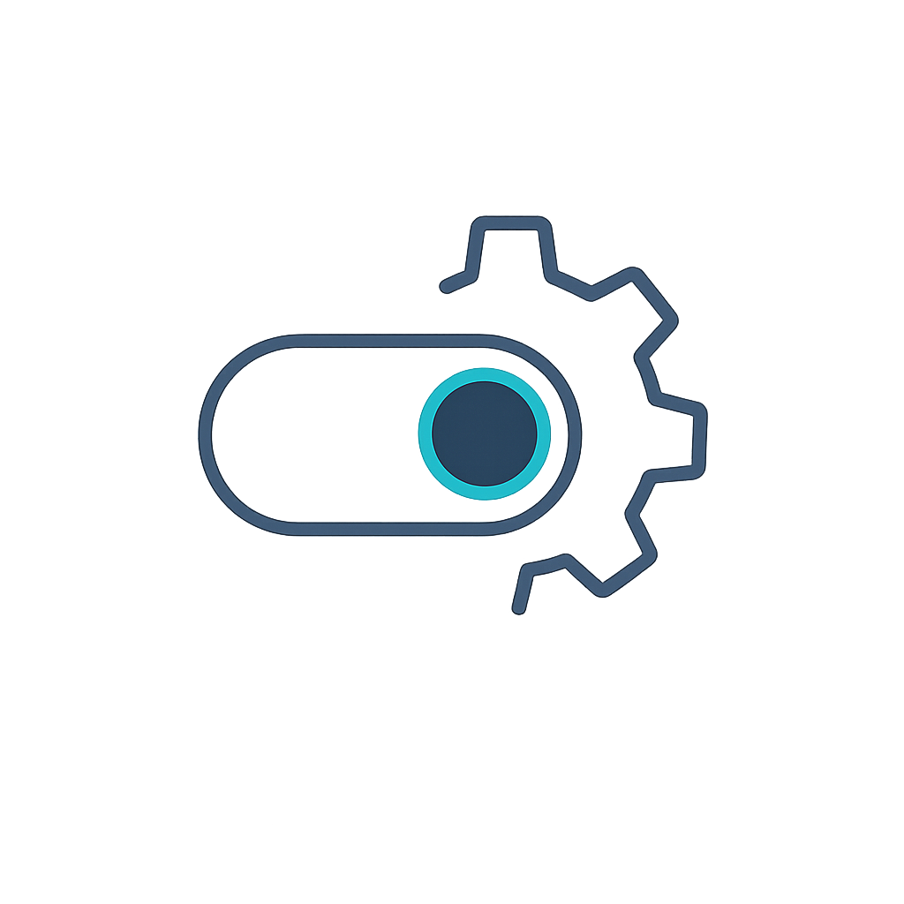

  

  # ⚙️ DevToggle | Secure Android Quick Settings Manager

  **The ultimate power-user tool for Android developers and enthusiasts.**
  
  
  
  

  *Supercharge your Android Quick Settings. Securely and instantly toggle Developer Options, ADB USB Debugging, and Wireless Debugging directly from your notification shade without root.*

By leveraging the power of [Shizuku](https://shizuku.rikka.app/), DevToggle acts as a secure, open-source Android settings manager that natively flips secure system configurations in the background. Stop navigating through complex menus and manage your Android developer tools instantly.

---

## ✨ Features

- **🚀 Instant Toggles**: Flip Developer Options, USB Debugging, and Wireless Debugging on or off instantly directly from your notification shade.
- **🔗 Custom Group Toggle**: Want to turn on Developer Options and USB Debugging at the exact same time? Configure a Custom Group Tile to flip multiple settings with a single tap!
- **⚡ Native Integration**: Uses Android's native Quick Settings Tiles (`QS_TILE`), making it feel like a built-in system feature.
- **🛡️ Secure & Private**: DevToggle utilizes Shizuku to execute commands locally. It requires no root, no weird accessibility workarounds, and collects absolutely **zero** data.
- **🎨 Beautiful UI**: A clean, modern Material You (Material 3) setup app that guides you through the process step-by-step.

---

## 🛠️ How It Works

Modern Android versions heavily restrict third-party apps from modifying secure system settings like `adb_enabled` or `development_settings_enabled`. 

DevToggle bypasses these restrictions cleanly by using **Shizuku**, an app that allows normal apps to temporarily borrow elevated system (`adb` or `root`) permissions. DevToggle uses Shizuku exactly once to grant itself the native `WRITE_SECURE_SETTINGS` permission. Once granted, it writes directly to the Android Settings provider for blazing fast, instant toggles!

---

## ❓ Frequently Asked Questions (FAQ)

**Does DevToggle require root access?**
No, DevToggle does not require a rooted device. It securely leverages Shizuku to obtain the necessary permissions via ADB wireless debugging.

**Is it safe to use Shizuku to manage Android settings?**
Yes. Shizuku is a widely trusted open-source tool. DevToggle only uses Shizuku once to grant itself the standard Android `WRITE_SECURE_SETTINGS` permission. It does not run background processes or connect to the internet.

**How do I turn on USB Debugging quickly without going to Settings?**
Simply install DevToggle, link it with Shizuku, and drag the "USB Debugging" tile into your Quick Settings notification shade. You can now toggle it with a single tap.

**Will this drain my battery?**
No. DevToggle contains no background services and collects absolutely zero analytics. It only executes exactly when you press the Quick Setting tile.

---

## 🚀 Getting Started

1. **Install Shizuku**: Get it from the [Google Play Store](https://play.google.com/store/apps/details?id=moe.shizuku.privileged.api) or [GitHub](https://github.com/RikkaApps/Shizuku).
2. **Start Shizuku**: Follow the instructions in the Shizuku app to start the service via Wireless Debugging (no root required) or Root.
3. **Open DevToggle**: Launch the DevToggle app.
4. **Grant Permissions**: Tap "Grant permission" to authorize DevToggle within Shizuku.
5. **Add Tiles**: Pull down your notification shade, tap the edit (pencil) icon, and drag your new DevToggle tiles into your active Quick Settings!

---

## 🧩 Available Quick Settings Tiles

- **Developer Options**: Globally enable or disable Android Developer mode. *(Note: Disabling this will automatically turn off USB and Wireless Debugging)*
- **USB Debugging**: Quickly allow adb connections over USB.
- **Wireless Debugging**: Quickly allow adb connections over Wi-Fi.
- **Custom Group**: A programmable tile! Open the DevToggle app to configure which settings this tile should turn on/off simultaneously.

---

## 🏗️ Build & Contribute

Want to build it yourself? 
1. Clone the repository.
2. Open the project in **Android Studio**.
3. Sync Gradle and hit **Run** on your physical device! *(Note: Shizuku and Quick Settings cannot be fully tested on standard Android Studio emulators without extra configuration).*

---

## 🔒 Privacy & Safety

DevToggle is an open-source, privacy-first application. 
- **No Internet Permission**: The app literally cannot connect to the internet.
- **No Analytics**: We don't track what you toggle or when.
- **No Background Battery Drain**: DevToggle only runs exactly when you tap a tile.

---
*Crafted for developers, by developers.*